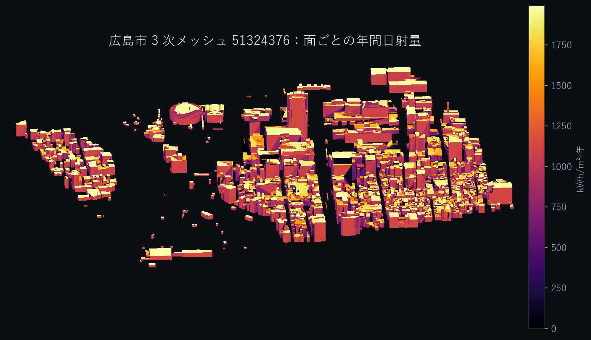
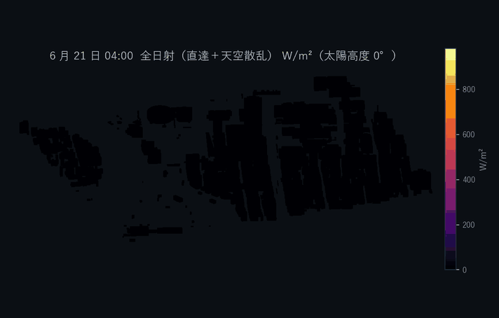
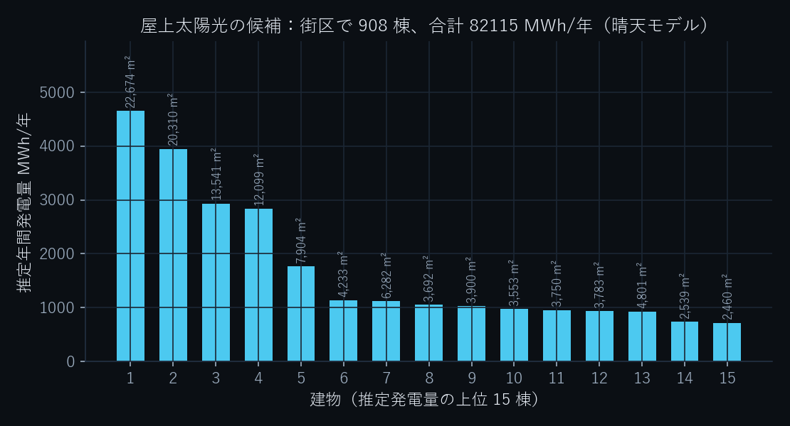
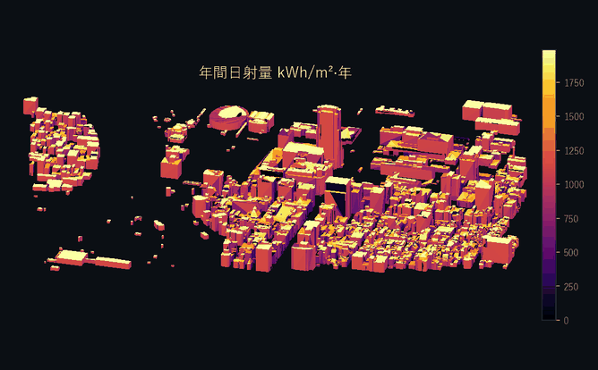

# Neuro3D × PLATEAU — 都市のなかで光を計算する

**街区まるごと 44,902 面の年間日射量と天空率を、16 コアの CPU で 40 秒。GPU は使いません。**
PLATEAU の 3D 都市モデル（CityGML LOD2）を、GPU の描画と同じやり方で解きます。

[](https://agnuxo1.github.io/neuro3d-plateau-irradiance/)
[](https://github.com/Agnuxo1/neuro3d-plateau-irradiance/actions/workflows/selftest.yml)
[](LICENSE)



> Whole-district solar irradiance and sky view factor on Project PLATEAU
> CityGML LOD2, computed as a rasterisation pass the way a 3D engine computes
> light, and validated against a Blender Cycles path-traced control on the same
> machine. Everything here is reproducible from the repository, the measured
> limits included.

---

## 成果 / Results — 1 分でわかる

| | |
|---|---|
| 計算した面 | **44,902 面**（広島市・3 次メッシュ 51324376、1,190 棟） |
| 光輸送の時間 | **40.0 秒**（16 コア CPU、太陽 141 位置＋天空 145 分割＝286 方向） |
| パストレーサとの一致 | **R² 0.985**、相対誤差の中央値 **2.6 %**（開けた 772 面） |
| 面の種類別の中央値 | 屋根 **1.2 %**・壁 **6.3 %**・LOD1 **4.0 %** |
| 同じ負荷での速さ | **26 倍**（同じ 900 面・同じ 286 方向で 40.6 秒 対 1,075.6 秒） |
| 街区全体に広げると | 1 面あたり **1,343 倍** |
| 対照そのものの校正 | 解析解に対し **2.2 × 10⁻⁶** |
| 追加の検証 | スケーリング・数値収束・**未見の都市への移植**・埋もれた面の検出 |

**[ブラウザでそのまま触れます →](https://agnuxo1.github.io/neuro3d-plateau-irradiance/)**
面にカーソルを合わせると、その面の年間日射量と天空率が読めます。インストール不要。

## 1 日の光を、そのまま計算する



色は計算した瞬時日射（直達＋天空散乱、W/m²）そのものです。6 月 21 日、20 分ごと。
影が街区を横切るたびに、全面を計算し直しています。

## 使いみち

- **自治体の都市計画・環境部局** — 屋上太陽光の適地抽出、日影規制の事前検討、
  緑化や広場の計画。入力は PLATEAU の CityGML だけで、追加の測量も商用ソフトも
  要りません。
- **設計事務所・エネルギー事業者** — 街区スケールの受熱・採光の初期検討。設計案を
  変えるたびに数十秒で解き直せます。
- **研究者・開発者** — PLATEAU を使った日射計算の、再現できるオープン基盤。
  コードは Apache-2.0、失敗した反復も含む全履歴つき。

## そのまま使える出力：屋上太陽光の候補



面ごとの数値は、そのままでは計画の役に立ちません。パネルが載る傾きの屋根面を棟ごとに
集計し、推定年間発電量の順に並べたものが `results/rooftop_top.csv` と、ビューアの
「屋上太陽光の候補」パネルです。

| | |
|---|---|
| 候補となる建物 | **908 棟** |
| 利用可能な屋根面積 | **357,655 m²** |
| 推定年間発電量（街区合計） | **82,115 MWh/年** |

係数はモジュール効率 20 %、システム出力係数 0.8。CSV には日射量そのものも
入っているので、別の係数で計算し直せます。**晴天モデルによる推定で、現地調査でも
実測でもありません。**実際の発電量は天候の分だけ下回ります。

## 考え方：描画として解く


光の方向ごとに、シーンを面の向きで 2 つに分け、**正射投影のデプスバッファ**へ点群で
書き込みます。あとは全クエリ点を 1 回のベクトル比較で判定するだけです。
1 方向のコストは「散布書き込み 1 回 ＋ 参照 1 回」で、**遮蔽物の数に依存しません**。

- **背面バッファ**（光に背を向けた面）＝ 市街の影。閉じた立体に入る光線は必ず背面を
  通るので、自己遮蔽を起こさずに、小さな厳密バイアスで判定できます。
- **前面バッファ**（光を向いた面）＝ 重なり合う立体に埋もれた面の検出。CityGML では
  立体が重なることがあり、そこから「出る」面は前面に写ります。

この構成が、光線を 1 本ずつ追う方法との違いです。街区を広げても、1 方向あたりの
仕事は増えません。



## 対照との一致

対照は **Blender Cycles 4.5.9**（CPU、512 サンプル）。太陽位置、晴天モデル
（Hottel ＋ Liu–Jordan）、**天空の範囲（上半球のみ）**、**相互反射なし**を両エンジンで
揃えてあります。対照側には、空が下半球から照らさないように黒い地表円盤を置いています。
評価は層化抽出した **900 面**、**測定前に合否条件を登録**（[CONTRATO-001](CONTRATO-001-irradiancia.md)）。

| 条件 | 実測 | 判定 |
|---|---|---|
| C1 対照の校正誤差 ≤ 3 %（上空の水平センサ 対 解析解） | **2.2 × 10⁻⁶** | 合格 |
| H2 計算コスト 20 倍以上（同じ 900 面で） | **26 倍** | 合格 |
| H3 遮蔽が効いていること | 遮蔽損失 39.0 %、天空率 p95 0.97 | 合格 |
| H1 精度（全 900 面） | R² 0.884 | 不合格 — [観察事項と限界](#観察事項と限界) |

開けた **772 面**（契約外の事後集計、そう明記します）では：

| 指標 | 値 | | 面の種類 | 比較数 | 中央値 | 偏り |
|---|---|---|---|---|---|---|
| R² | **0.985** | | 屋根面 | 250 | **1.2 %** | +2.5 % |
| 平均の偏り | +4.0 % | | 壁面 | 233 | **6.3 %** | +8.4 % |
| 相対誤差の中央値 | **2.6 %** | | LOD1 面 | 289 | **4.0 %** | +4.4 % |


### 計算コスト

| 条件 | Neuro3D | Cycles 対照 | 比 |
|---|---|---|---|
| 同じ 900 面、同じ 286 方向 | 40.6 秒 | 1,075.6 秒 | **26 倍** |
| 街区全体 44,902 面（対照は 900 面のまま） | 40.0 秒 | — | 1 面あたり **1,343 倍** |

**26 倍が同じ負荷での正直な数字**で、1,343 倍は街区規模に広げたときの 1 面あたりの
コスト比です。前処理（法線と埋もれた面の検出、約 27 秒）は計測に含めていません。
GPU では測っていないので主張しません。


<!-- TESTS -->

## 解析解による単体試験

データなしで走り、CI で毎コミット実行されます。

**影そのもの**（`code/selftest_shadow.py`）

| 試験 | 解析値 | 実測 | 差 |
|---|---|---|---|
| T1 遮蔽なしの地面の天空率 | 1.000 | 1.000 | 0.000 |
| T2 高い壁の足元の天空率 | 0.500 | 0.519 | +0.019 |
| T3 箱の影／日なた／屋根（4 点） | 0 / 1 / 1 / 1 | 一致 | — |
| T4 正方形中庭の中心の天空率 | 0.554 | 0.588 | +0.034 |

**埋もれた面の検出**（`code/selftest_sealed.py`、合成形状で答えがわかっている 3 例）

| 試験 | 鉛直判定 | 3 次元の多数決 |
|---|---|---|
| 閉じた箱の中の箱：内側 12 面すべて | 12 / 12 | 12 / 12 |
| **屋根のない箱**の中の箱：内側 12 面すべて | **0 / 12** | **12 / 12** |
| 離れた 2 つの箱：偽陽性なし | 0 | 0 |

2 行目が、鉛直の判定を 3 次元に置き換えた理由です。CityGML の立体は水密とは限らず、
上向きの判定だけでは内部を内部と判定できません。

## 再現手順

```bash
pip install -r requirements.txt

# 1. PLATEAU から必要なタイル 1 枚だけを取得（ZIP 全体はダウンロードしない）
python code/fetch_plateau.py \
  --url https://assets.cms.plateau.reearth.io/assets/ef/d3f4c5-aca6-415e-b560-d86512e004f9/34100_hiroshima-shi_city_2022_citygml_3_op.zip \
  --extract udx/bldg/51324376_bldg_6697_op.gml --out data_plateau

# 2. CityGML → 局所 ENU メートル系の三角形メッシュ
python code/citygml_mesh.py --gml data_plateau/51324376_bldg_6697_op.gml \
  --out data_plateau/tile_51324376.npz

# 3. 外向き法線と埋もれた面の検出（前処理。計測時間には含めない）
python code/orient_normals.py --tile data_plateau/tile_51324376.npz \
  --out data_plateau/normals_51324376.npz            # --enclosure majority3d も可

# 4. 自前エンジン＋Cycles 対照＋同負荷測定＋契約の判定（Blender は自動取得）
python code/run_pilot.py --tile data_plateau/tile_51324376.npz \
  --normals data_plateau/normals_51324376.npz --outdir results

# 5. 追加の 4 つの検証（名古屋タイルも自動で使います）
python code/run_tests.py --outdir pruebas --device cpu
```

図・PDF・動画も同じ結果ファイルから作られます
（`code/figures.py`、`code/visuals.py`、`code/dossier.py`、`code/video2.py`）。
`code/neuro3d_irradiance.py` は `--device cuda` で GPU でも動きますが、本リポジトリの
計測は CPU のみです。

## リポジトリの構成

```
code/         エンジン、対照、検証、図・PDF・動画の生成
docs/         結果の図
media/        静止画と GIF（README と PDF が参照）
results/      公開した測定の結果と meta（CONTRATO-001.json）
pruebas/      追加 4 検証の結果（P1…P4）
experiments/  失敗した反復を含む全履歴
submission/   応募用 PDF・動画・日本語の応募本文
web/          three.js ビューア（GitHub Pages で公開）
```

## データとライセンス

元の CityGML は**再配布しません**。`code/fetch_plateau.py` が HTTP レンジ要求で
必要な 1 タイル（30 MB）だけを取り出します（ZIP 全体は 2.7 GB）。
ただし **ビューアは派生物を同梱します**：`web/district.bin` は同タイルから作成した
三角形メッシュと計算結果で、PLATEAU サイトポリシーに従い、ページ上に出典を明記して
公開しています。

コードは Apache-2.0（[LICENSE](LICENSE)）。第三者の構成要素は [NOTICE](NOTICE) に記載。
データは国土交通省 Project PLATEAU（広島市・名古屋市 2022 年度 CityGML、
G 空間情報センター）。

## 観察事項と限界

通らなかった条件も、原因のわからない差も、そのまま載せます。数値はすべて
`results/`・`pruebas/`・[experiments/LOG.md](experiments/LOG.md) から追えます。

- **事前登録した精度条件 H1 は、全 900 面では通っていません。**
  R² 0.884（要求 0.90）、平均の偏り +11.9 %（要求 10 %）、95 パーセンタイル
  57,265 %（要求 40 %）。原因は特定済みで、900 面のうち **128 面**が重なり合う
  CityGML 立体に封じられた面であり、対照はほぼ 0、本エンジンは光を返します。
  残る 772 面では R² 0.985 です。
- **数値の収束は、公開した設定では完全ではありません。** 下の P2 が示すとおり、
  デプステクセルと点密度を変えると答えは数十 % 動きます。公開した設定は
  その中の 1 点であり、対照との一致はその設定での一致です。
- **T2・T4 の解析解との差（+0.019、+0.034）は原因を特定できていません。**
  145 分割の離散化だけでは説明がつかず（離散化のみなら T4 は 0.517）、デプス
  バッファの取りこぼしによる天空の過大評価が残っていると見ています。
- **晴天モデルによる計算値で、実測気象データではありません。** 相互反射・植生・
  地形は両エンジンとも含めていません。
- **「事前登録」は自己申告です**（ファイルの作成時刻が根拠）。E02–E08 の反復は
  同じ対照・同じ街区に対して行ったもので、独立した検証用データはありません
  （その穴を埋めるために P3 を追加しました）。
- **GPU では測っていないので、GPU の速さは主張しません。**
- **第三者による独立監査は未了です。**

## 状態

PLATEAU AWARD 2026 一般部門（国土交通省）への応募作品。本エントリー締切は
2026-11-19 23:59 JST。応募そのものは作者本人が行います。
数値は 2026-10-31 の実行によるものです。

制作：Francisco Angulo de Lafuente（個人応募）
