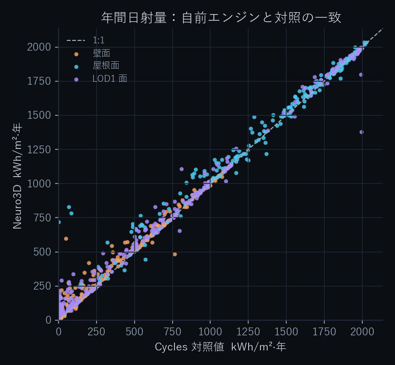
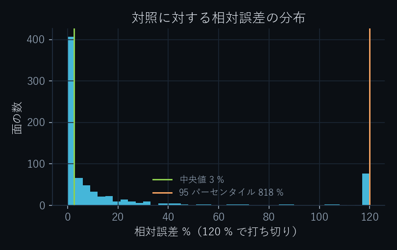
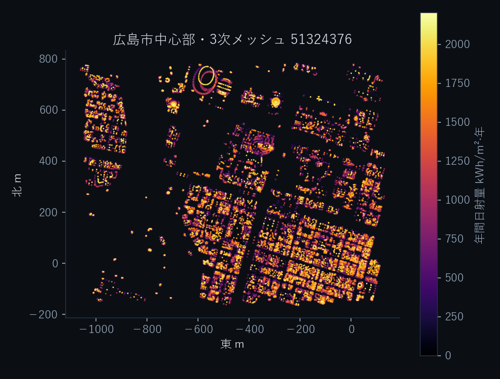
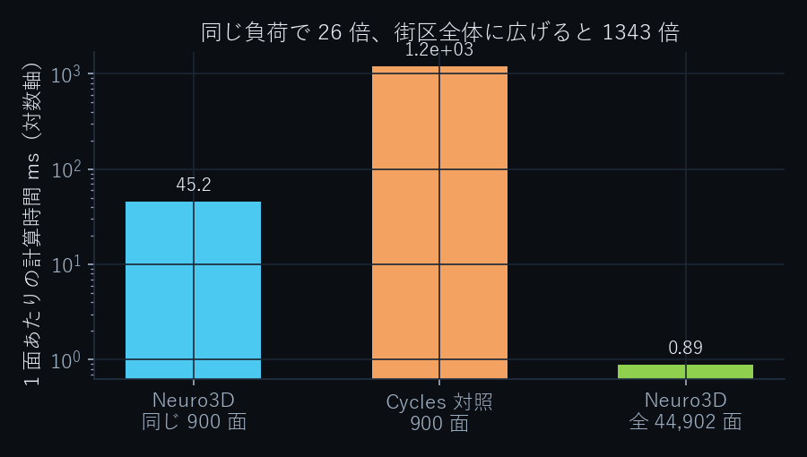

# Neuro3D × PLATEAU — 都市のなかで光を計算する / Urban irradiance by rasterisation

**ビューア / live viewer:** https://agnuxo1.github.io/neuro3d-plateau-irradiance/

PLATEAU の 3D 都市モデル（CityGML LOD2）に対し、**GPU の描画と同じやり方**で
日射と日影を解くエンジンと、その検証一式です。パストレーサ（Blender Cycles）を
対照に置き、事前に登録した合否条件（[CONTRATO-001](CONTRATO-001-irradiancia.md)）で
測りました。**事前条件は通っていません**。その中身もそのまま載せています。

An engine that computes urban solar irradiance on Project PLATEAU CityGML LOD2
the way a 3D engine computes light — as a rasterisation pass over the whole
scene — validated against a Blender Cycles path-traced control under
pre-registered acceptance criteria. **Those criteria were not met**; the
measurement and the reason are published here as they came out.

---

## 何をしたか / What this does

対象：広島市 2022 年度 CityGML LOD2、3 次メッシュ **51324376**（平和記念公園・紙屋町周辺）。
1,190 棟、46,862 三角形。うち 1,924 面は重なり合う立体に封じられた面として除外、
36 面は退化、残る **44,902 面**を計算します。出力は面ごとの年間日射量
（kWh/m²·年、直達と天空散乱に分離）と天空率。

光の方向ごとに、シーンを面の向きで分けた **2 枚の正射投影デプスバッファ**に点群で
書き込み、全クエリ点を 1 回のベクトル比較で判定します。1 方向のコストは「散布書き込み 1 回 ＋ 参照 1 回」で、
遮蔽物の数に依存しません。

- **背面バッファ**（光に背を向けた面）＝ 市街の影。閉じた立体に入るときに必ず通る面なので、
  自己遮蔽なしに、小さな厳密バイアスで判定できます。
- **前面バッファ**（光を向いた面）＝ 体積に埋もれた面の検出。CityGML では立体が重なることが
  あり、そこから「出る」面は前面です。クエリ面自身も写るため、テクセル内の自面の奥行き幅を
  覆う傾斜バイアスを使います。

## 結果 / Results

対照：Blender Cycles 4.5.9（CPU、512 サンプル）。太陽位置・晴天モデル（Hottel +
Liu–Jordan）・**天空の範囲（上半球のみ）**・**相互反射なし**を両エンジンで揃えて
あります。対照側は、空が下半球からも照らさないように地表面として黒い円盤を置いて
います。実行は 16 コア CPU（PyTorch 4 スレッド）、太陽 141 位置＋天空 145 分割 ＝ 286 方向。
評価は層化抽出した **900 面**。

### 事前登録した条件（全 900 面で判定）

| 条件 | 実測 | 判定 |
|---|---|---|
| C1 対照の校正誤差 ≤ 3 %（上空の水平センサ 対 解析解） | 2.2 × 10⁻⁶ | **合格** |
| H1 決定係数 R² ≥ 0.90 | 0.884 | **不合格** |
| H1 平均の偏り ≤ 10 % | +11.9 % | **不合格** |
| H1 相対誤差の中央値 ≤ 15 % | **4.8 %** | 合格 |
| H1 相対誤差の 95 パーセンタイル ≤ 40 % | 57,265 % | **不合格** |
| H2 計算コスト 20 倍以上（同じ 900 面で） | **26 倍** | 合格 |
| H3 遮蔽が効いていること | 遮蔽損失 39.0 %、天空率 p95 0.97 | 合格 |

**H1 は不合格です。** 原因は一つに特定できています。900 面のうち **128 面**は、
重なり合う CityGML 立体に封じられた面で、対照はほぼ 0 を返し、本エンジンは光を返します
（平均で数百 kWh/m²·年の過大）。封じられた面の検出器は 1,924 面を見つけますが、
取りこぼしがこれだけ残ります。この 128 面が R²・偏り・95 パーセンタイルの三つを落として
います。

### 残り 772 面（契約外の事後集計、そう明記します）

| 指標 | 値 |
|---|---|
| R² | 0.985 |
| 平均の偏り | +4.0 % |
| 相対誤差の中央値 | 2.6 % |
| 95 パーセンタイル | 818 % |

| 面の種類 | 比較数 | 相対誤差の中央値 | 平均の偏り | 対照の平均 |
|---|---|---|---|---|
| 屋根面 | 250 | **1.2 %** | +2.5 % | 1,443 kWh/m²·年 |
| 壁面 | 233 | **6.3 %** | +8.4 % | 421 kWh/m²·年 |
| LOD1 面 | 289 | **4.0 %** | +4.4 % | 783 kWh/m²·年 |

### 計算コスト

| 条件 | Neuro3D | Cycles 対照 | 比 |
|---|---|---|---|
| 同じ 900 面、同じ 286 方向 | 40.6 秒 | 1,075.6 秒 | **26 倍** |
| 街区全体 44,902 面（対照は 900 面のまま） | 40.0 秒 | — | 1 面あたり **1,343 倍** |

1 方向のコストが面の数にほぼ依存しないので、街区全体に広げるほど差が開きます。
**26 倍が同じ負荷での正直な数字**で、1,343 倍は街区規模に広げたときの 1 面あたりの
コスト比です。前処理（法線と封じられた面の検出、約 27 秒）は計測に含めていません。
GPU では測っていないので主張しません。

日射量の分布（全 44,902 面）：中央値 414、95 パーセンタイル 1,906、最大 2,205 kWh/m²·年。
平均天空率 0.44。天空率の 5 パーセンタイルが 0.00 なのは、下向きの底面が多数あるためです。
**晴天モデルによる計算値であり、実測気象データではありません。**






## 解析解による単体試験 / Analytic self-tests

データなしで走り、CI で毎回実行されます（`code/selftest_shadow.py`）。

| 試験 | 解析値 | 実測 | 差 |
|---|---|---|---|
| T1 遮蔽なしの地面の天空率 | 1.000 | 1.000 | 0.000 |
| T2 高い壁の足元の天空率 | 0.500 | 0.519 | +0.019 |
| T3 箱の影／日なた／屋根（4 点） | 0 / 1 / 1 / 1 | 一致 | — |
| T4 正方形中庭の中心の天空率 | 0.554 | 0.588 | +0.034 |

T2・T4 の差は**原因を特定できていません**。145 分割の離散化だけでは説明がつかず
（離散化のみなら T4 は 0.517 になるはずで、実測はそれより上）、デプスバッファの
取りこぼしによる天空の過大評価が残っていると見ています。拡散成分の絶対値は、
遮蔽なしの厳密値 DHI·(1+cos β)/2 に可視率を掛けて求めているため、無遮蔽の場合には
離散化の偏りは入りません。

## 再現手順 / Reproducing

```bash
pip install -r requirements.txt
# 1. PLATEAU から必要なタイル 1 枚だけを取得（ZIP 全体はダウンロードしない）
python code/fetch_plateau.py \
  --url https://assets.cms.plateau.reearth.io/assets/ef/d3f4c5-aca6-415e-b560-d86512e004f9/34100_hiroshima-shi_city_2022_citygml_3_op.zip \
  --extract udx/bldg/51324376_bldg_6697_op.gml --out data_plateau
# 2. CityGML → 局所 ENU メートル系の三角形メッシュ
python code/citygml_mesh.py --gml data_plateau/51324376_bldg_6697_op.gml \
  --out data_plateau/tile_51324376.npz
# 3. 外向き法線と封じられた面の検出（前処理。計測時間には含めない）
python code/orient_normals.py --tile data_plateau/tile_51324376.npz \
  --out data_plateau/normals_51324376.npz
# 4. 自前エンジン＋Cycles 対照＋同負荷測定＋契約の判定（Blender は自動取得）
python code/run_pilot.py --tile data_plateau/tile_51324376.npz \
  --normals data_plateau/normals_51324376.npz --outdir results
```

`code/neuro3d_irradiance.py` は `--device cuda` で GPU でも動きますが、本リポジトリの
計測は CPU のみです。

## このリポジトリが言えないこと / What is not claimed

- **事前条件を満たしたとは言えません。** H1 は不合格です。
- 実測日射との一致。気象データも現地測定もありません。晴天モデルの計算値です。
- この街区の外での精度。1 タイルでしか測っていません。E02–E08 の反復はいずれも
  同じ対照・同じ街区に対して行ったもので、独立した検証用データはありません。
- 「事前登録」は自己申告です（ファイルの作成時刻が根拠）。
- 相互反射、植生、地形。両エンジンで同じように除いてあります。
- Cycles が絶対の真値であること。対照であり、512 サンプルのばらつきを持ちます。
- GPU 実装の速度。CPU のみの測定です。

## データとライセンス / Data and licence

元の CityGML は**再配布しません**。`code/fetch_plateau.py` が HTTP レンジ要求で
必要な 1 タイル（30 MB）だけを取り出します（ZIP 全体は 1 GB）。
ただし **ビューアは派生物を同梱します**：`web/district.bin` は同タイルから作成した
三角形メッシュ（38,309 面）と計算結果で、PLATEAU サイトポリシーに従い、ページ上に
出典を明記して公開しています。

コードは Apache-2.0（[LICENSE](LICENSE)）。第三者の構成要素は [NOTICE](NOTICE) に記載。

## 状態 / Status

PLATEAU AWARD 2026 一般部門（国土交通省）への応募作品として作成。
本エントリー締切は 2026-11-19 23:59 JST。応募そのものは作者本人が行います。
数値は 2026-10-31 の実行（`results/`）によるもので、独立した第三者監査は未了です。
反復の全履歴（失敗したものを含む）は [experiments/LOG.md](experiments/LOG.md)。
