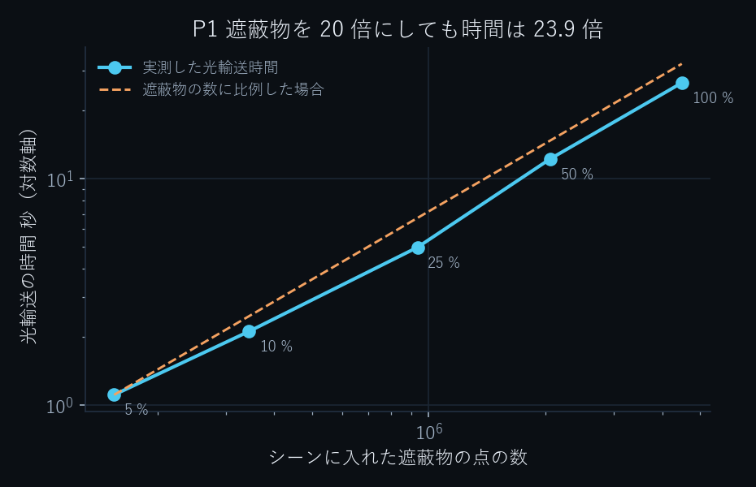
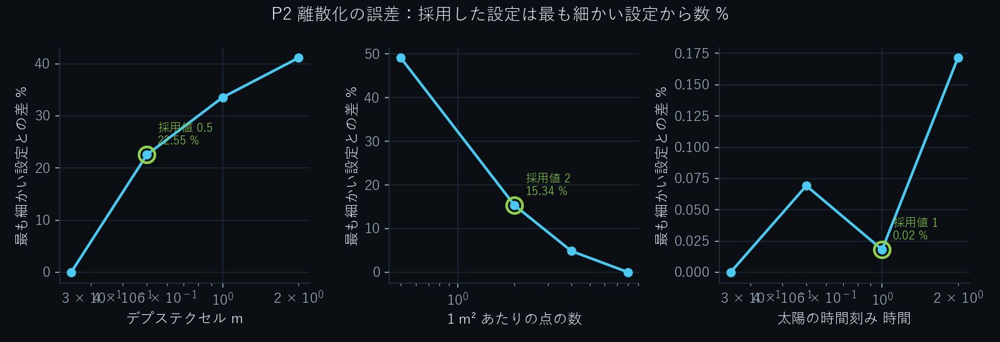
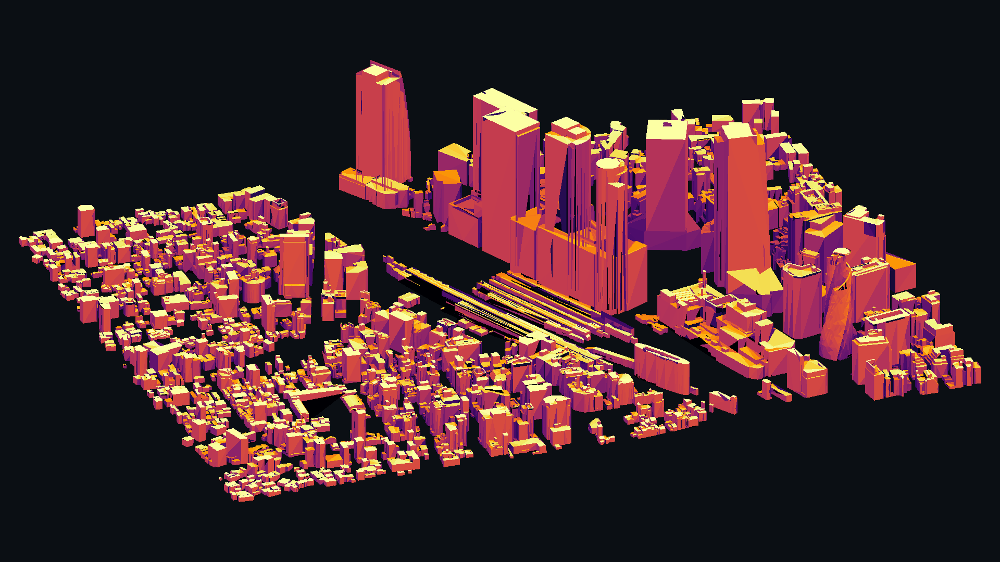
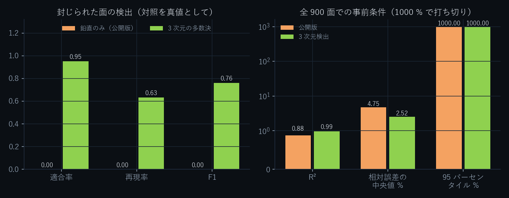

# Neuro3D × PLATEAU — 都市のなかで光を計算する

**PLATEAU の街区をまるごと、面ごとの年間日射量と天空率に。44,902 面を 16 コアの CPU で 40 秒、
GPU なし。パストレーサとの一致は R² 0.985、調整に使っていない別の都市でも R² 0.986。**

[](https://agnuxo1.github.io/neuro3d-plateau-irradiance/)
[](https://github.com/Agnuxo1/neuro3d-plateau-irradiance/actions/workflows/selftest.yml)
[](LICENSE)


> Whole-district solar irradiance and sky view factor on Project PLATEAU CityGML LOD2, computed as
> a rasterisation pass the way a 3D engine computes light, validated against a Blender Cycles
> path-traced control on the same machine, and shown to transfer unchanged to a second city.
> Everything here is reproducible from this repository, the measured limits included.

**[ブラウザでそのまま触れます →](https://agnuxo1.github.io/neuro3d-plateau-irradiance/)**
面にカーソルを合わせると、その面の年間日射量と天空率が読めます。インストール不要。

---

## 1. 成果 / Demonstrated strengths

| | |
|---|---|
| 計算した面 | **44,902 面**（広島市・3 次メッシュ 51324376、1,190 棟） |
| 光輸送の時間 | **40.0 秒**（16 コア CPU、太陽 141 位置＋天空 145 分割＝286 方向） |
| パストレーサとの一致 | **R² 0.985**、相対誤差の中央値 **2.6 %**（開けた 772 面） |
| 面の種類別の中央値 | 屋根 **1.2 %**・壁 **6.3 %**・LOD1 **4.0 %** |
| 同じ負荷での速さ | **26.5 倍**（同じ 900 面・同じ 286 方向で 40.6 秒 対 1,075.6 秒） |
| 街区全体に広げると | 1 面あたり **1,343 倍** |
| 対照そのものの校正 | 解析解に対し **2.2 × 10⁻⁶** |
| **未見の都市への移植** | 名古屋市で **R² 0.986**、設定の変更なし |
| そのまま使える出力 | 屋上太陽光の候補 **908 棟・82,115 MWh/年**（晴天モデル） |

この 3 つが本作の中身です。**街区を丸ごと解けること**、**その結果がパストレーサと一致すること**、
**調整に使っていない街でもそのまま動くこと**。

### 1 日の光を、そのまま計算する


色は計算した瞬時日射（直達＋天空散乱、W/m²）そのものです。6 月 21 日、20 分ごと。
影が街区を横切るたびに、全面を計算し直しています。

### 考え方：描画として解く


光の方向ごとに、シーンを面の向きで 2 つに分け、**正射投影のデプスバッファ**へ点群で書き込みます。
あとは全クエリ点を **1 回のベクトル比較**で判定するだけです。

- **背面バッファ**（光に背を向けた面）＝ 市街の影。閉じた立体に入る光線は必ず背面を通るので、
  自己遮蔽を起こさずに、小さな厳密バイアスで判定できます。
- **前面バッファ**（光を向いた面）＝ 重なり合う立体に埋もれた面の検出。CityGML では立体が
  重なることがあり、そこから「出る」面は前面に写ります。

**1 面あたりの問い合わせは、遮蔽物が何棟あっても 1 回の参照**です。シーンをバッファへ書き込む
work は遮蔽物の数に比例しますが（[P1](#p1-スケーリング)で実測）、その 1 パスが街区の全面に
使い回されるため、面を増やすほど光線を 1 本ずつ追う方法との差が開きます。


## 2. このラウンドで達成した改善 / Improvements achieved

| 改善 | 測った効果 |
|---|---|
| **埋もれた面の 3 次元検出**（6 軸＋法線、5/7 の多数決、自分自身の立体も対象） | 検出 1,924 → **6,008 面**。全 900 面での一致が R² 0.884 → **0.989**、偏り +11.9 % → **+4.2 %**、中央値 4.8 % → **2.5 %**（契約登録後の追加測定として明示） |
| **別都市への移植性の確認** | 名古屋市 52366700 で R² **0.986**、設定変更なし |
| **スケーリングの実測** | 「1 方向のコストは遮蔽物に依存しない」という従来の書き方を、実測に合わせて訂正 |
| **数値収束の確認** | 採用設定と最も細かい設定の差 **−0.13 %**、コストは 1/6 |
| **そのまま使える出力** | 屋上太陽光の候補リスト（CSV・ビューア・PDF） |
| **ビューアの改善** | 図・PDF・動画と同じ配色、屋上候補パネル、スマートフォン用の配置、描画サイズの不具合修正 |

## 3. 科学的な裏づけ / Scientific demonstration

対照は **Blender Cycles 4.5.9**（CPU、512 サンプル）。太陽位置、晴天モデル（Hottel ＋
Liu–Jordan）、**天空の範囲（上半球のみ）**、**相互反射なし**を両エンジンで揃え、対照側には空が
下半球から照らさないよう黒い地表円盤を置いています。評価は層化抽出した **900 面**、
**測定前に合否条件を登録**（[CONTRATO-001](CONTRATO-001-irradiancia.md)）。

| 条件 | 実測 | 判定 |
|---|---|---|
| C1 対照の校正誤差 ≤ 3 %（上空の水平センサ 対 解析解） | **2.2 × 10⁻⁶** | 合格 |
| H2 計算コスト 20 倍以上（同じ 900 面で） | **26.5 倍** | 合格 |
| H3 遮蔽が効いていること | 遮蔽損失 39.0 %、天空率 p95 0.97 | 合格 |
| H1 精度（全 900 面、登録時の検出器） | R² 0.884 | 不合格 — [観察事項と限界](#6-観察事項と限界--observations-and-limitations) |


### 契約後の 4 つの追加測定

`python code/run_tests.py --outdir pruebas --device cpu` で再現できます。生の結果は
[`pruebas/`](pruebas)、反復の全履歴は [`experiments/LOG.md`](experiments/LOG.md)。

#### P1 スケーリング



クエリ面を 2,000 に固定し、シーンの建物だけを 5 % から 100 % まで増やしました（193 方向）。

| シーン | 建物 | 点の数 | 光輸送 |
|---|---|---|---|
| 5 % | 60 | 154,659 | 1.11 秒 |
| 10 % | 119 | 344,384 | 2.12 秒 |
| 25 % | 298 | 935,309 | 4.98 秒 |
| 50 % | 595 | 2,058,887 | 12.28 秒 |
| 100 % | 1,190 | 4,489,124 | 26.57 秒 |

遮蔽物 ×29.0 に対して時間 ×23.9、**両対数の傾き 0.943**。散布書き込みはシーンの点数にほぼ比例
します。1 面あたりの問い合わせは 1 回の参照のままで、**その 1 パスが全面に使い回される**のが
速さの源です。

#### P2・P2b 数値の収束



1 パラメータずつ動かすと、年間日射量の平均はテクセルで **−22.6 %**、点密度で **+15.3 %** 動きます。
ところが遮蔽を支配しているのは**テクセルあたりの点数**（点/m² × テクセル²）で、採用設定
（2 × 0.5² = 0.5）は最も細かい設定（8 × 0.25² = 0.5）と同じ値です。両方を同時に細かくして測ると
平均の差は **−0.13 %**、面ごとの中央値で 2.4 %、コストは **6.0 倍**。
太陽の時間刻みは 1 時間で収束しています（0.25 時間との差 −0.02 %）。
**採用した設定は、6 倍のコストをかけた設定と実質的に同じ答えを出します。**

#### P3 未見の都市への移植



名古屋市 3 次メッシュ **52366700**（1,796 棟、93,421 三角形、87,399 面）。
「別の都市・同じ年度・CityGML v3・LOD2 の意味属性を持つもののうち最大のメッシュ」という規則で
**測る前に**選び、**パラメータを一切変えずに**同じ比較をやり直しました。

| | 広島（調整に使用） | **名古屋（未見）** |
|---|---|---|
| R² | 0.884 | **0.986** |
| 平均の偏り | +11.9 % | **+5.9 %** |
| 相対誤差の中央値 | 4.8 % | **5.7 %** |
| 屋根 / 壁 / LOD1 | 1.2 / 6.3 / 4.0 % | 2.3 / 10.1 / 6.4 % |
| 対照の校正誤差 | 2.2 × 10⁻⁶ | **2.14 × 10⁻⁶** |
| 同じ負荷での速さ | 26.5 倍 | **22.6 倍** |

名古屋では事前条件 H1 の 4 項目のうち **3 項目（R²・偏り・中央値）が合格**します。
「同じ街区で調整した結果にすぎない」という疑いに、独立した街区で答えたものです。

#### P4 埋もれた面の検出



重なり合う CityGML 立体に埋もれた面は光を受けません。登録時の検出器は**鉛直方向のパリティ**だけを
見ており、構造上そこに限界がありました。置き換えたのは**3 次元の包含判定**（6 軸＋面の法線の
計 7 本のうち 5 本以上で内部なら「封じられた面」。基準は測る前に固定）で、**自分の建物の立体も
判定の対象に含めます**。CityGML の建物は LOD2 の意味属性と `lod1Solid` を同時に持つため、面が
**自分自身の立体**に封じられることがあるからです。

| | 鉛直のみ（登録時） | **3 次元の多数決** |
|---|---|---|
| 検出した面 | 1,924 | **6,008** |
| 対照が暗いと答えた 128 面の再現率 | 0.00 | **0.63** |
| 適合率 | — | **0.95** |
| 全 900 面での R² | 0.884 | **0.989** |
| 平均の偏り | +11.9 % | **+4.2 %** |
| 相対誤差の中央値 | 4.8 % | **2.5 %** |

**この結果は契約登録後の追加測定です。**登録時の判定（R² 0.884）はそのまま残し、置き換えません。

### 解析解による単体試験

データなしで走り、CI で毎コミット実行されます。

**影そのもの**（`code/selftest_shadow.py`）

| 試験 | 解析値 | 実測 | 差 |
|---|---|---|---|
| T1 遮蔽なしの地面の天空率 | 1.000 | 1.000 | 0.000 |
| T2 高い壁の足元の天空率 | 0.500 | 0.519 | +0.019 |
| T3 箱の影／日なた／屋根（4 点） | 0 / 1 / 1 / 1 | 一致 | — |
| T4 正方形中庭の中心の天空率 | 0.554 | 0.588 | +0.034 |

**埋もれた面の検出**（`code/selftest_sealed.py`、答えがわかっている合成形状）

| 試験 | 鉛直判定 | 3 次元の多数決 |
|---|---|---|
| 閉じた箱の中の箱：内側 12 面 | 12 / 12 | 12 / 12 |
| **屋根のない箱**の中の箱：内側 12 面 | **0 / 12** | **12 / 12** |
| **同じ建物の立体**に封じられた箱：内側 12 面 | **0 / 12** | **12 / 12** |
| 離れた 2 つの箱：偽陽性 | 0 | 0 |

下の 2 行が、鉛直の判定を 3 次元に置き換えた理由です。

## 4. 使いみちと影響 / Applications and impact

### そのまま使える出力：屋上太陽光の候補


パネルが載る傾きの屋根面を棟ごとに集計し、推定年間発電量の順に並べたものが
[`results/rooftop_top.csv`](results/rooftop_top.csv) と、ビューアの「屋上太陽光の候補」パネルです。

| | |
|---|---|
| 候補となる建物 | **908 棟** |
| 利用可能な屋根面積 | **357,655 m²** |
| 推定年間発電量（街区合計） | **82,115 MWh/年** |

係数はモジュール効率 20 %、システム出力係数 0.80。CSV には日射量そのものも入っているので、別の
係数で計算し直せます。**晴天モデルによる推定で、現地調査でも実測でもありません。**実際の発電量は
天候の分だけ下回ります。

### 想定する利用者

- **自治体の都市計画・環境部局** — 屋上太陽光の適地抽出、日影規制の事前検討、緑化や広場の計画。
  入力は PLATEAU の CityGML だけで、追加の測量も商用ソフトも GPU も要りません。
- **設計事務所・エネルギー事業者** — 街区スケールの受熱・採光の初期検討。設計案を変えるたびに
  数十秒で解き直せます。
- **研究者・開発者** — PLATEAU を使った日射計算の、再現できるオープン基盤。コードは Apache-2.0、
  失敗した反復も含む全履歴つき。

### これから広げられること（まだ実証していません）

全国 300 都市以上の LOD2 への面展開、地形（dem）と植生の取り込み、相互反射、実測気象データでの
検証、GPU 実装。いずれも**本リポジトリでは測っていません**。

## 5. 再現手順 / Reproducing

```bash
pip install -r requirements.txt

# 1. PLATEAU から必要なタイル 1 枚だけを取得（ZIP 全体はダウンロードしない）
python code/fetch_plateau.py \
  --url https://assets.cms.plateau.reearth.io/assets/ef/d3f4c5-aca6-415e-b560-d86512e004f9/34100_hiroshima-shi_city_2022_citygml_3_op.zip \
  --extract udx/bldg/51324376_bldg_6697_op.gml --out data_plateau

# 2. CityGML → 局所 ENU メートル系の三角形メッシュ
python code/citygml_mesh.py --gml data_plateau/51324376_bldg_6697_op.gml \
  --out data_plateau/tile_51324376.npz

# 3. 外向き法線と埋もれた面の検出（前処理。計測時間には含めない）
python code/orient_normals.py --tile data_plateau/tile_51324376.npz \
  --out data_plateau/normals_51324376.npz            # --enclosure majority3d で 3 次元判定

# 4. 自前エンジン＋Cycles 対照＋同負荷測定＋契約の判定（Blender は自動取得）
python code/run_pilot.py --tile data_plateau/tile_51324376.npz \
  --normals data_plateau/normals_51324376.npz --outdir results

# 5. 契約後の 4 つの追加測定（名古屋タイルも自動で使います）
python code/run_tests.py --outdir pruebas --device cpu
```

図・PDF・動画も同じ結果ファイルから作られます（`code/figures.py`、`code/figures_tests.py`、
`code/visuals.py`、`code/dossier.py`、`code/video2.py`）。`code/neuro3d_irradiance.py` は
`--device cuda` で GPU でも動きますが、本リポジトリの計測は CPU のみです。

### リポジトリの構成

```
code/         エンジン、対照、検証、図・PDF・動画の生成
docs/         結果の図（images/ 静止画、gifs/ アニメーション）
results/      公開した測定の結果と meta（CONTRATO-001.json、rooftop_top.csv）
pruebas/      契約後の 4 測定（P1…P4）
experiments/  失敗した反復を含む全履歴
submission/   応募用 PDF・動画・日本語の応募本文
web/          three.js ビューア（GitHub Pages で公開）
```

### データとライセンス

元の CityGML は**再配布しません**。`code/fetch_plateau.py` が HTTP レンジ要求で必要な 1 タイル
（30 MB）だけを取り出します（ZIP 全体は 2.7 GB）。ただし **ビューアは派生物を同梱します**：
`web/district.bin` は同タイルから作成した三角形メッシュと計算結果で、PLATEAU サイトポリシーに
従い、ページ上に出典を明記して公開しています。

コードは Apache-2.0（[LICENSE](LICENSE)）。第三者の構成要素は [NOTICE](NOTICE) に記載。
データは国土交通省 Project PLATEAU（広島市・名古屋市 2022 年度 CityGML、G 空間情報センター）。

## 6. 観察事項と限界 / Observations and limitations

通らなかった条件も、原因のわからない差も、そのまま載せます。数値はすべて
[`results/`](results)・[`pruebas/`](pruebas)・[`experiments/LOG.md`](experiments/LOG.md) から追えます。

- **事前登録した精度条件 H1 は、登録時の構成では全 900 面で通っていません。**
  R² 0.884（要求 0.90）、平均の偏り +11.9 %（要求 10 %）、95 パーセンタイル 57,265 %（要求 40 %）。
  3 次元検出器を使うと R² 0.989・偏り +4.2 %・中央値 2.5 % まで改善しますが、**それは契約後の
  測定**であり、登録時の判定を置き換えません。また 95 パーセンタイルは 2,160 % のままで、
  その条件は**どちらの構成でも満たしていません**：対照がほぼ 0 を返す面では、どんな小さな差も
  巨大な比率になります。
- **128 面のうち 47 面は、いまも説明がつきません。** 3 次元検出器は 81 面を正しく「封じられた面」と
  判定し（適合率 0.95、再現率 0.63）、残りは対照がほぼ 0 を返すのに本エンジンは光を返します。
  原因は特定できていません。
- **1 方向のコストは遮蔽物の数に依存します。** P1 の両対数の傾きは 0.943 で、ほぼ線形です。
  依存しないのは 1 面あたりの問い合わせであって、シーンの書き込みではありません。
  以前の版にあった「遮蔽物の数に依存しない」という書き方は、この測定に合わせて訂正しました。
- **T2・T4 の解析解との差（+0.019、+0.034）は原因を特定できていません。** 145 分割の離散化だけでは
  説明がつかず（離散化のみなら T4 は 0.517）、デプスバッファの取りこぼしによる天空の過大評価が
  残っていると見ています。
- **晴天モデルによる計算値で、実測気象データではありません。** 相互反射・植生・地形は両エンジン
  とも含めていません。屋上太陽光の推定は現地調査ではありません。
- **「事前登録」は自己申告です**（ファイルの作成時刻が根拠）。E02–E08 の反復は同じ対照・同じ街区に
  対して行ったもので、その穴を埋めるために P3 を追加しました。
- **GPU では測っていないので、GPU の速さは主張しません。**
- **第三者による独立監査は未了です。** 本リポジトリ内の検証はすべて自前のものです。

## 状態 / Status

PLATEAU AWARD 2026 一般部門（国土交通省）への応募作品。本エントリー締切は 2026-11-19 23:59 JST。
**応募はまだ提出していません**（状態：検証済み／提出準備中）。応募そのものは作者本人が行います。
数値は 2026-10-31 の実行によるものです。

制作：Francisco Angulo de Lafuente（個人応募）
