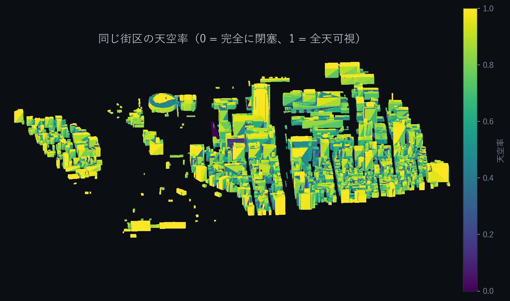
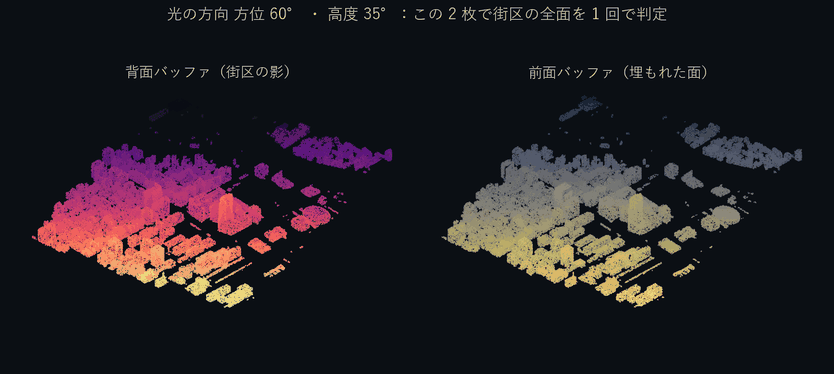

# Neuro3D × PLATEAU — 都市の光を、街区まるごと可視化
### Urban irradiance at district scale · Scientific, open, interactive

**都市の 3D モデルを、日射・日影・天空率が読める都市計画の地図へ。**

Neuro3D × PLATEAU は、国土交通省 Project PLATEAU の CityGML LOD2 から、屋根・壁など**面ごとの年間日射量と天空率**を計算するオープンソース・エンジンです。光線を面ごとに追う代わりに、方向別の**前面・背面デプスバッファ**を使い、街区全体を一括評価します。

**[▶ Open the live 3D viewer](https://agnuxo1.github.io/neuro3d-plateau-irradiance/)** · **[Presentation PDF](submission/PLATEAU_AWARD_2026_Neuro3D_VisualReview.pdf)** · **[Demonstration video (MP4)](submission/PLATEAU_AWARD_2026_Neuro3D.mp4)** · **[Japanese application text — updated](submission/PLATEAU_APPLICATION_FINAL_JA.md)**


## 実証した強み / Verified strengths

| Evidence from the Hiroshima 2022 tile | Recorded result |
|---|---:|
| Buildings in study tile | **1,190** |
| Original triangles / computed triangles | **46,862 / 44,902** |
| Equal workload: CPU transport comparison against Cycles (900 surfaces) | **26.46×** |
| Whole-district transport pass | **39.96 s** (CPU, preprocessing excluded) |
| Agreement on 772 non-dark control probes (post-hoc subgroup) | **R² = 0.985** |
| Median relative error, roofs / walls / LOD1 (same subgroup) | **1.2% / 6.3% / 4.0%** |
| Calibrated Cycles horizontal open-sky reference error | **2.2 × 10⁻⁶** |

*The 772-probe result is a descriptive post-hoc subgroup, **not** the official 900-probe pre-registered score. The 26.46× comparison uses the same 900 queried surfaces and 286 light directions; it is not a universal speedup claim. No GPU speed claim is made.*

## 見て、動かして、理解する / Explore the project

| Annual solar exposure | Sky view factor |
|---|---|
|  |  |

**アニメーションは計算済みの街区メッシュと実測定配列を使った再可視化です。** Conceptual illustrations are not substituted for measured values.

**1 · Rotate the computed district / 360° 都市モデル**


**2 · Sun position through one clear-sky day / 一日の直達・天空散乱**


**3 · Front/back depth buffers / 2 枚の深度バッファ**



For interactive surface interrogation (annual irradiance and sky view factor), visit the [live 3D viewer](https://agnuxo1.github.io/neuro3d-plateau-irradiance/).

## 何が新しいか / How it works

1. Download only the required PLATEAU CityGML building tile (rather than the whole source archive).
2. Preserve semantic categories while converting buildings into local-metre triangles.
3. Determine outward normals and flag enclosed or overlapping CityGML faces.
4. For each of 141 sun positions and 145 sky patches, rasterise directional depth information.
5. Query all applicable surfaces against the resulting buffers to calculate direct and diffuse exposure.
6. Export an interactive city visualisation with per-surface values.

The solution is designed for **early-stage planning and exploration**: rooftop solar screening, façade exposure, urban shade and open-space evaluation. The clear-sky calculations are **not** field-measured irradiance forecasts.

## 追加した独立した分析 / New independent analytical checks

Three new **CPU-only, post-hoc** analyses were executed against the existing measurement arrays (not against a new city or an independently rerun Cycles baseline). Raw values, input SHA-256 hashes, bootstrap seed and reproducible source are available in [results/independent_review_20261031.json](results/independent_review_20261031.json) and [code/independent_review_20261031.py](code/independent_review_20261031.py).

| Analytical test | New finding |
|---|---|
| **A. Physical invariants** | **0 violations** among 44,902 kept surfaces: finite positive geometry, non-negative irradiance, sky view in [0,1], no shaded energy above unshaded energy |
| **B. Area weighting** | 601.60 kWh/m²·year per triangle versus **550.24 kWh/m²·year per m²** (−8.54%); data are unchanged, only weighting differs |
| **C. Stratified uncertainty** | Full 900-probe R² **0.8839**, bootstrap 95% interval **0.8464–0.9124** (1,000 resamples, seed 20261031) |

The bootstrap conditions on the original stratified probe selection, cannot eliminate spatial autocorrelation, and does not alter the original pre-registered verdict. These checks complement rather than replace the analytical geometry self-tests and the original full Cycles comparison.

### Scientific evidence and original experiments

- [Experimental contract — CONTRATO-001](CONTRATO-001-irradiancia.md)
- [Raw evaluation metrics](results/CONTRATO-001.json)
- [Independent numerical audit, raw output](results/independent_review_20261031.json)
- [Experiment log (including unsuccessful iterations)](experiments/LOG.md)
- [Third-party licences, datasets and attribution](NOTICE)

The benchmark compares the in-house engine against **Blender Cycles 4.5.9 CPU, 512 samples** with the same sun positions and comparable clear-sky illumination assumptions; it is a *reference implementation*, not ground-truth meteorology.

### Reproduction

```bash
pip install -r requirements.txt
python code/selftest_shadow.py

# First download/convert the published PLATEAU tile, then run:
python code/run_pilot.py --tile data_plateau/tile_51324376.npz \
    --normals data_plateau/normals_51324376.npz --outdir results

# CPU-only independent post-hoc audit, using numerical outputs from the pilot:
python code/independent_review_20261031.py \
    --engine results/neuro3d.npz \
    --pairs results/CONTRATO-001.json.pairs.npz \
    --output results/independent_review_20261031.json
```

The complete acquisition / mesh conversion / normal-preprocessing commands are in [the original acquisition protocol](CONTRATO-001-irradiancia.md) and [code](code/). The large NPZ arrays and the original GML are not checked into Git: download or regenerate them before running the complete pipeline.

## 応募資料 / PLATEAU AWARD 2026

- [Visual Japanese PDF (new edition)](submission/PLATEAU_AWARD_2026_Neuro3D_VisualReview.pdf)
- [Video demonstration](submission/PLATEAU_AWARD_2026_Neuro3D.mp4)
- [Japanese application text — updated](submission/PLATEAU_APPLICATION_FINAL_JA.md)
- [Interactive project viewer](https://agnuxo1.github.io/neuro3d-plateau-irradiance/)

**Application status:** materials prepared; **no official submission is claimed without an organiser receipt.** General Division deadline: **19 November 2026, 23:59 JST**.

## 観察事項と限界 / Observations and limitations

The original pre-registered **H1 accuracy criterion was not met** on all 900 probes: R² **0.884**, mean bias **+11.9%**, and p95 relative error **57,265%** (unstable ratios for near-zero references, with some materially overestimated enclosed surfaces). The likely dominant contributor is **128 enclosed faces** within overlapping CityGML solids, for which the original enclosure detector was incomplete. The 772-probe post-hoc results above are not a replacement for that primary analysis. The numerical engine and reference omit measured weather, vegetation, terrain and interreflection; performance is reported for the stated CPU workload, with preprocessing excluded. Independent cross-city validation remains a separate requirement for generalisation claims.

These limitations are the basis for focused future experiments; they do not negate the verified district-scale computation, observed timing or the value of open reproducible workflows.

## Source and licences

City models: **Japan Ministry of Land, Infrastructure, Transport and Tourism — Project PLATEAU**, Hiroshima 2022 CityGML LOD2, mesh 51324376. The public interactive viewer includes an attributed derived district mesh; the original CityGML is obtained from its publisher. Source code: **Apache-2.0**, see [LICENSE](LICENSE) and [NOTICE](NOTICE). Project by Francisco Angulo de Lafuente.
